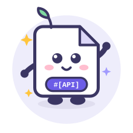

# Apidoc

基于 PHP 8 attributes 的 API 文档生成与接口开发工具，兼容 Laravel、ThinkPHP、Hyperf、Webman、Yii2、Yii3

[](https://packagist.org/packages/erikwang2013/apidoc-php)
[](https://packagist.org/packages/erikwang2013/apidoc-php)
[](https://packagist.org/packages/erikwang2013/apidoc-php)
[](https://packagist.org/packages/erikwang2013/apidoc-php)
[](https://github.com/erikwang2013/apidoc-php)
[](https://github.com/erikwang2013/apidoc-php)

## 📖项目介绍

Apidoc 是一款通过解析 **PHP 8 attributes** 自动生成 API 接口文档的 PHP 扩展包，兼容 Laravel、ThinkPHP、Hyperf、Webman、Yii2、Yii3 等主流框架。除文档自动生成外，还集成了在线接口调试、Mock 调试数据、Json/TypeScript 代码生成、接口生成器、代码生成器等能力，覆盖接口开发、调试、交付的全流程，致力于提升 API 开发效率。

> **项目来源**：本项目源自 [HGthecode/apidoc-php](https://github.com/HGthecode/apidoc-php)，继承其 attributes 注解体系与配置结构，并在此基础上移除了 doctrine/annotations 旧注解依赖、仅支持 PHP 8 attributes（PHP >= 8.0），由 erikwang2013 持续维护与扩展。

### ✨项目说明

- **开箱即用**：无需繁杂配置，安装后按文档编写 attributes 即可自动生成 API 文档。
- **轻松编写**：支持通用注释定义（definitions）、数据表字段的 `ref` / `table` 引用，几句注解即可完成完整字段定义。
- **在线调试**：文档页内直接调试接口，支持全局参数带入、Mock 数据、前置/后置调试事件。
- **多应用/多版本**：单应用、多应用、多版本项目均可配置，接口按应用/版本分组展示与切换。
- **分组/Tag**：控制器与接口支持多级分组与 Tag 标记。
- **Markdown 文档**：可将 `.md` 文件挂载为文档页。
- **Json/TypeScript 生成**：每个接口自动生成 Json 请求/响应示例与 TypeScript 类型定义，直接用于前端。
- **代码生成器**：配置 + 模板即可生成业务代码、数据表与前端 Api 文件。
- **接口分享**：可生成指定应用/接口的分享链接、导出 `swagger.json`。
- **安全访问**：支持全局密码与应用/版本独立密码授权，可开启文档缓存。

## 🚀快速开始

安装：

```bash
composer require erikwang2013/apidoc-php
```

配置应用目录与通用定义（不同框架的配置发布方式略有差异，详见下方使用文档“框架接入”；ThinkPHP 为例，编辑 `config/apidoc.php`）：

```php
return [
    'apps' => [
        ['title' => 'Api接口', 'path' => 'app\controller', 'key' => 'api'],
    ],
    'definitions' => "app\common\controller\Definitions",
];
```

在控制器中通过 PHP 8 attributes 编写接口注解：

```php
use erikwang2013\apidoc\annotation as Apidoc;

#[Apidoc\Title("用户")]
#[Apidoc\Desc("用户相关接口")]
class User
{
    #[Apidoc\Method("GET")]
    #[Apidoc\Url("/user/info")]
    #[Apidoc\Query(name: "id", type: "int", require: true, desc: "用户ID")]
    #[Apidoc\Returned(name: "nickname", type: "string", desc: "昵称")]
    public function info()
    {
        // ...
    }
}
```

访问 `http://你的域名/apidoc` 即可查看自动生成的接口文档（在线调试、Mock、Json/TypeScript 生成等能力开箱即用）。


## 📌兼容

以下框架已内置兼容，可开箱即用

| 框架     | 版本     | 说明                                 |
| -------- |--------| ------------------------------------ |
| ThinkPHP | \>=5.1 |                                      |
| Webman   | \>=1.x |                                      |
| Laravel  | \>=8.x | 低于 Laravel8 版本未测试，可自行尝试 |
| Hyperf   | \>=2.x |                                      |
| Yii2     | \>=2.0  | 需开启 urlManager 的 enablePrettyUrl，手动调用 `Yii2Service::register()` |
| Yii3     | \>=3.0  | 手动调用 `Yii3Service::register($container, $config)` |


## 📖使用文档

[Attributes 使用说明](docs/ATTRIBUTES.md)

（安装与框架接入、注解写法教程、参数说明）


## 🏆支持我们

如果本项目对您有所帮助，请点个Star支持我们

- [Github](https://github.com/erikwang2013/apidoc-php) [](https://github.com/erikwang2013/apidoc-php)

<!-- pet-expressions:start -->
## 项目宠物表情形态 · Apidoc

<table align="center">
<tr><td align="center"><br><b>笑</b><br><code>:emoji-smile:</code></td><td align="center"><br><b>欢乐</b><br><code>:emoji-joy:</code></td><td align="center"><br><b>哭</b><br><code>:emoji-cry:</code></td><td align="center"><br><b>沮丧</b><br><code>:emoji-depressed:</code></td><td align="center"><br><b>惊恐</b><br><code>:emoji-terrified:</code></td><td align="center"><br><b>愤怒</b><br><code>:emoji-angry:</code></td></tr>
<tr><td align="center"><br><b>撒娇</b><br><code>:emoji-coquettish:</code></td><td align="center"><br><b>卖萌</b><br><code>:emoji-cute:</code></td><td align="center"><br><b>讨好</b><br><code>:emoji-pleasing:</code></td><td align="center"><br><b>敲打</b><br><code>:emoji-knocking:</code></td><td align="center"><br><b>捂脸</b><br><code>:emoji-facepalm:</code></td><td align="center"><br><b>吐舌头</b><br><code>:emoji-tongue:</code></td></tr>
</table>

> 12 种彩色动态形态：笑 / 欢乐 / 哭 / 沮丧 / 惊恐 / 愤怒 / 撒娇 / 卖萌 / 讨好 / 敲打 / 捂脸 / 吐舌头。每个 SVG 自带表情、情绪特效与整体动效，并遵循 `prefers-reduced-motion`。
<!-- pet-expressions:end -->

<!-- assets-license:start -->
## 视觉资产授权 / Visual Assets License

本项目的项目宠物、图片、图标、表情（包括 `docs/pet-expressions/` 等目录下的
SVG / PNG）**不是开源资产**，版权归作者所有。未经书面许可不得复制、修改、再分发或
用于商业用途；商业使用需取得商业授权，联系 **erik@erik.xyz**。详见
[ASSETS-LICENSE.md](ASSETS-LICENSE.md)。

> 代码部分仍遵循仓库原有 `LICENSE`；第三方素材（如明确标注的 Go Gopher 等）仍遵循其原许可证。
<!-- assets-license:end -->

