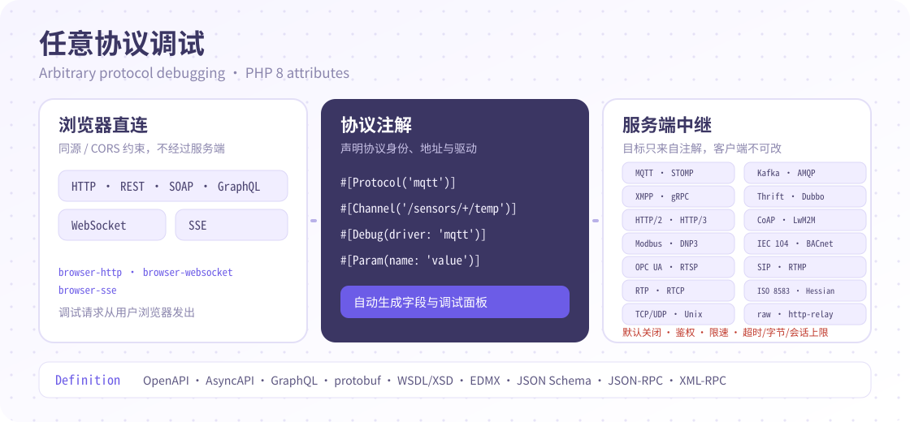

# Attributes 使用说明（PHP 8 原生注解）

本文档为基于 **PHP 8 attributes**（`#[注解(...)]`）的使用说明，不含 doctrine 旧注解（`@注解`）写法。示例均使用本项目命名空间 `erikwang2013\apidoc`。

## 〇、安装与框架接入

```bash
composer require erikwang2013/apidoc-php
```

要求 PHP >= 8.0（attributes 语法）。安装后文档默认挂在 `/apidoc` 路由下（可通过配置键 `route_prefix` 修改）。

| 框架 | 接入方式 |
| --- | --- |
| Laravel >= 8 | 经 `extra.laravel.providers` 自动注册，无需手动添加 Provider；执行 `php artisan vendor:publish --provider="erikwang2013\apidoc\providers\LaravelService"` 发布配置到 `config/apidoc.php` |
| ThinkPHP >= 5.1 | 经 `extra.think.services` 自动注册（TP5 使用 `ThinkPHP5Service`）；`extra.think.config` 将包内 `src/config.php` 合并为应用配置键 `apidoc`（`config/apidoc.php`） |
| Hyperf >= 2 | `extra.hyperf.config` 指向 `erikwang2013\apidoc\ConfigProvider`，自动注册；将包内 `src/config.php` 复制到 `config/autoload/apidoc.php` |
| Webman >= 1 | 插件机制：安装后在项目根目录执行 `php webman install`，配置发布到 `config/plugin/erikwang2013/apidoc/`（`app.php` 为主配置，`route.php` 自动注册 `/apidoc` 路由） |
| Yii2 >= 2.0 | 入口脚本（`web/index.php`）中在应用创建后、`$app->run()` 前手动调用 `Yii2Service::register()`（需开启 urlManager 的 `enablePrettyUrl`）；配置通过 `params['apidoc']` 提供 |
| Yii3 >= 3.0 | 手动调用 `Yii3Service::register($container[, $config])`；配置通过 `params['apidoc']` 提供 |

以 ThinkPHP 为例的最小配置（`config/apidoc.php`）：

```php
return [
    'apps' => [
        ['title' => 'Api接口', 'path' => 'app\controller', 'key' => 'api'],
    ],
    'definitions' => "app\common\controller\Definitions",
];
```

## 一、引入 Apidoc 注解

编写注解前必须先引入注解类，否则不会被解析。

### 引入方式一（推荐）

用一个别名引入全部注解：

```php
<?php
namespace app\controller;

// 添加这句
use erikwang2013\apidoc\annotation as Apidoc;

#[Apidoc\Title("基础示例")]
class ApiDocTest
{
    #[Apidoc\Title("测试接口")]
    public function index()
    {
        //...
    }
}
```

### 引入方式二

分别引入需要用到的注解类，书写时使用短类名：

```php
<?php
namespace app\controller;

use erikwang2013\apidoc\annotation\Title;
use erikwang2013\apidoc\annotation\Group;
use erikwang2013\apidoc\annotation\Desc;
use erikwang2013\apidoc\annotation\Author;
use erikwang2013\apidoc\annotation\Url;
use erikwang2013\apidoc\annotation\Tag;
use erikwang2013\apidoc\annotation\Param;
use erikwang2013\apidoc\annotation\Returned;
// ...按需引入

#[Title("基础示例")]
#[Group("base")]
class ApiDocTest
{
    #[Title("测试接口")]
    public function index()
    {
        //...
    }
}
```

## 二、控制器注解

为控制器加上注解，可让文档可读性更高（不是必须的）：

```php
<?php
namespace app\controller;

use erikwang2013\apidoc\annotation as Apidoc;

#[Apidoc\Title("基础示例")]
#[Apidoc\Group("base")]
#[Apidoc\Sort(1)]
#[Apidoc\NotParse()]
#[Apidoc\NotDebug()]
class ApiDocTest
{
    //...
}
```

### 注释参数

| 参数名 | 参数值 | 说明 |
| - | - | - |
| `Title` | | 控制器标题 |
| `Group` | 定义在配置文件 `groups` 中分组的 name | 所属分组 |
| `Sort` | number | 控制器排序 |

### 特殊参数

| 参数名 | 说明 |
| - | - |
| `NotParse` | 不需要解析 API 文档的控制器 |
| `NotDebug` | 关闭该控制器下所有接口的调试 |

## 三、接口注解

控制器中的每一个符合注释规则的方法都会被解析成一个 API 接口。

### 1、Header 参数

通过 `Header` 注解定义 HTTP 请求的 Header 参数：

```php
<?php
namespace app\controller;

use erikwang2013\apidoc\annotation as Apidoc;

#[Apidoc\Title("基础示例")]
class ApiDocTest
{
    #[
        Apidoc\Title("请求头参数"),
        Apidoc\Method("GET"),
        Apidoc\Header(name: "token", type: "string", require: true, desc: "Token"),
        Apidoc\Query(name: "id", type: "int", require: true, desc: "信息id"),
        Apidoc\Returned(name: "id", type: "int", desc: "信息id"),
    ]
    public function header()
    {
        //...
    }
}
```

### 2、Query 参数

通过 `Query` 注解定义 HTTP 请求的 Query（URL 查询）参数：

```php
<?php
namespace app\controller;

use erikwang2013\apidoc\annotation as Apidoc;

#[Apidoc\Title("基础示例")]
class ApiDocTest
{
    #[
        Apidoc\Title("请求Query参数"),
        Apidoc\Method("GET"),
        Apidoc\Query(name: "name", type: "string", require: true, desc: "姓名"),
        Apidoc\Query(name: "phone", type: "string", require: true, desc: "手机号"),
        Apidoc\Returned(name: "id", type: "int", desc: "用户id"),
    ]
    public function query()
    {
        //...
    }
}
```

### 3、Body 参数

通过 `Param` 注解定义 HTTP 请求的 body 参数：

```php
<?php
namespace app\controller;

use erikwang2013\apidoc\annotation as Apidoc;

#[Apidoc\Title("基础示例")]
class ApiDocTest
{
    #[
        Apidoc\Title("请求Body参数"),
        Apidoc\Method("POST"),
        Apidoc\Param(name: "name", type: "string", require: true, desc: "姓名"),
        Apidoc\Param(name: "phone", type: "string", require: true, desc: "手机号"),
        Apidoc\Returned(name: "id", type: "int", desc: "用户id"),
    ]
    public function body()
    {
        //...
    }
}
```

### 4、路由参数

通过 `RouteParam` 注解定义路由传参，如 `url/{name}/{phone}`：

```php
<?php
namespace app\controller;

use erikwang2013\apidoc\annotation as Apidoc;

#[Apidoc\Title("基础示例")]
class ApiDocTest
{
    #[
        Apidoc\Title("路由参数"),
        Apidoc\Method("POST"),
        Apidoc\RouteParam(name: "name", type: "string", require: true, desc: "姓名"),
        Apidoc\RouteParam(name: "phone", type: "string", require: true, desc: "手机号"),
        Apidoc\Returned(name: "id", type: "int", desc: "用户id"),
    ]
    public function route(Request $request, $name, $phone)
    {
        //...
    }
}
```

### 5、响应参数

通过 `Returned` 注解定义 HTTP 请求的响应参数：

```php
<?php
namespace app\controller;

use erikwang2013\apidoc\annotation as Apidoc;

#[Apidoc\Title("基础示例")]
class ApiDocTest
{
    #[
        Apidoc\Title("响应参数"),
        Apidoc\Method("GET"),
        Apidoc\Query(name: "id", type: "int", require: true, desc: "用户id"),
        Apidoc\Returned(name: "id", type: "int", desc: "用户id"),
        Apidoc\Returned(name: "name", type: "string", desc: "姓名"),
        Apidoc\Returned(name: "phone", type: "string", desc: "电话"),
    ]
    public function returned()
    {
        //...
    }
}
```

## 四、通用注解（definitions）

通过定义通用的公共注释来实现复用，避免每个接口都定义一大堆同样的参数。

### 1、增加配置

首先在配置文件中，指定一个文件为定义公共注释的类：

```php
// apidoc.php
// 指定公共注释定义的文件地址
'definitions' => "app\controller\Definitions",
```

### 2、定义通用注解

添加一些通用的方法及注解（`Header`、`Query`、`Param`、`Returned` 参数与接口注解书写规则一致）：

```php
<?php
namespace app\controller;

use erikwang2013\apidoc\annotation as Apidoc;

class Definitions
{
    #[
        Apidoc\Query(name: "pageIndex", type: "int", require: true, default: 1, desc: "查询页数"),
        Apidoc\Query(name: "pageSize", type: "int", require: true, default: 20, desc: "查询条数"),
        Apidoc\Returned(name: "total", type: "int", desc: "总条数"),
    ]
    public function pagingParam() {}

    #[
        Apidoc\Returned(name: "id", type: "int", desc: "唯一id"),
        Apidoc\Returned(name: "name", type: "string", desc: "字典名"),
        Apidoc\Returned(name: "value", type: "string", desc: "字典值"),
    ]
    public function dictionary() {}

    #[Apidoc\Header(name: "shopid", type: "string", require: true, desc: "店铺id")]
    public function shopHeader() {}
}
```

### 3、使用定义

在接口注解的 `Header`、`Query`、`Param`、`RouteParam`、`Returned` 中可通过 `ref` 引用通用注解：

```php
<?php
namespace app\controller;

use erikwang2013\apidoc\annotation as Apidoc;
use app\controller\Definitions;

class ApiDocTest
{
    #[
        Apidoc\Title("引用公共注解"),
        Apidoc\Method("GET"),
        Apidoc\Header(ref: "shopHeader"),
        Apidoc\Query(ref: [Definitions::class, "pagingParam"]),
        Apidoc\Returned(ref: [Definitions::class, "pagingParam"]),
        Apidoc\Returned(name: "data", type: "array", ref: "dictionary", desc: "字典列表"),
    ]
    public function definitions()
    {
        //...
    }
}
```

> 以上 `Returned` 用了两种方式引入：指定字段名与 type 时，引入的参数挂在该字段下；不指定字段名时，直接引入所有参数。

## 五、逻辑层注解

实际开发中业务逻辑会分层处理（service 层），可直接引入业务逻辑层的注解来实现接口参数的定义。

### 1、定义逻辑层注解

在项目 app 目录下新建 `services` 文件夹，新建 `ApiDocService.php`：

```php
<?php
namespace app\services;

use erikwang2013\apidoc\annotation as Apidoc;

class ApiDocService
{
    #[
        Apidoc\Param(name: "id", type: "int", require: true, desc: "唯一id"),
        Apidoc\Param(name: "sex", type: "int", require: true, desc: "性别"),
        Apidoc\Param(name: "age", type: "int", require: true, desc: "年龄"),
        Apidoc\Returned(name: "id", type: "int", desc: "唯一id"),
        Apidoc\Returned(name: "name", type: "string", desc: "姓名"),
        Apidoc\Returned(name: "phone", type: "string", desc: "电话"),
    ]
    public function getUserInfo() {}
}
```

### 2、引用逻辑层注解

在控制器的接口注解中通过 `ref` 指定引入逻辑层的注解，以下三种 `ref` 写法等价：

```php
<?php
namespace app\controller;

use erikwang2013\apidoc\annotation as Apidoc;
use app\services\ApiDocService;

class ApiDocTest
{
    #[
        Apidoc\Title("引入逻辑层注解"),
        Apidoc\Method("POST"),
        Apidoc\Param(ref: "app\services\ApiDocService@getUserInfo"),
        Apidoc\Param(ref: "app\services\ApiDocService\getUserInfo"),
        Apidoc\Param(ref: [ApiDocService::class, "getUserInfo"]),
        Apidoc\Returned(ref: [ApiDocService::class, "getUserInfo"]),
    ]
    public function service()
    {
        //...
    }
}
```

## 六、模型注解

接口参数往往与数据表息息相关，很多接口参数来自数据表字段。可以直接引入指定模型的数据表字段来生成参数说明，省去大量注解与维护工作。

### 1、给数据表字段添加注释

建议为数据表字段添加注释，可读性更高（示例 SQL 供参考）：

```sql
CREATE TABLE `user` (
  `id` int(11) NOT NULL AUTO_INCREMENT COMMENT '用户id',
  `username` varchar(64) NOT NULL COMMENT '用户名',
  `nickname` varchar(64) DEFAULT NULL COMMENT '昵称',
  `avatar` varchar(255) DEFAULT NULL COMMENT '头像',
  `name` varchar(64) DEFAULT NULL COMMENT '姓名',
  `phone` varchar(11) DEFAULT NULL COMMENT '联系电话',
  `role` varchar(255) DEFAULT NULL COMMENT '角色',
  PRIMARY KEY (`id`)
) ENGINE=MyISAM AUTO_INCREMENT=23 DEFAULT CHARSET=utf8;
```

### 2、直接引用数据表字段

某些表没有模型文件时，可直接使用 `table` 参数指定要解析的表：

```php
<?php
namespace app\controller;

use erikwang2013\apidoc\annotation as Apidoc;

class ApiDocTest
{
    #[
        Apidoc\Title("直接引用数据表"),
        Apidoc\Method("POST"),
        Apidoc\Param(name: "userList", type: "array", desc: "用户列表", table: "users"),
    ]
    public function table()
    {
        //...
    }
}
```

> 使用 `table` 引用前，需在配置文件的 `database` 配置项中配置数据库连接。

### 3、模型方法的注解

可为模型方法添加注解，实现 `Field`（返回指定字段）、`WithoutField`（排除指定字段）、`AddField`（添加/覆盖指定字段）：

| 参数 | 说明 | 书写规范 |
| - | - | - |
| `Field` | 返回指定字段 | 数组或英文逗号分隔的字段名 |
| `WithoutField` | 排除指定字段 | 数组或英文逗号分隔的字段名 |
| `AddField` | 添加指定字段 | 可定义多个，每行一个参数；可嵌套 `children` 定义复杂层级 |
| ├─ 字段名 | | 如 `Apidoc\AddField(name: "name", ...)` |
| ├─ `type` | 字段类型 | |
| ├─ `require` | 是否必填 | |
| ├─ `default` | 默认值 | |
| ├─ `desc` | 字段说明文字 | |
| └─ `children` | 子参数 | |

```php
<?php
namespace app\model;

use erikwang2013\apidoc\annotation as Apidoc;

class User extends BaseModel
{
    #[
        Apidoc\Field(["id", "username", "nickname", "role"]),
        Apidoc\AddField(name: "openid", type: "string", desc: "OpenId"),
        Apidoc\AddField(name: "role", type: "array", desc: "重写 role，由于数据表中存在该字段，此处定义会覆盖数据表中的字段", children: [
            ['name' => 'name', 'type' => 'string', 'desc' => '角色名称'],
            ['name' => 'id', 'type' => 'int', 'desc' => '角色id'],
        ]),
    ]
    public function getInfo($id)
    {
        //...
    }
}
```

### 4、引用模型注解

```php
<?php
namespace app\controller;

use erikwang2013\apidoc\annotation as Apidoc;
use app\model\User as UserModel;

class ApiDocTest
{
    #[
        Apidoc\Title("引入模型注解"),
        Apidoc\Method("POST"),
        Apidoc\Param(ref: "app\model\User@getInfo", desc: "引入指定模型的 getInfo 方法，会通过 getInfo 的注解处理数据表字段"),
        Apidoc\Param(ref: [UserModel::class, "getUserInfo"], desc: "同上"),
        Apidoc\Param(ref: "app\model\User", desc: "直接引入该模型数据表字段"),
        Apidoc\Param(ref: UserModel::class, desc: "同上"),
        Apidoc\Returned(ref: UserModel::class),
    ]
    public function model()
    {
        //...
    }
}
```

## 七、实体类引用

### 1、实体类参数注解

实体类的属性使用 `Property` 注解：

```php
<?php
namespace app\entity;

use erikwang2013\apidoc\annotation as Apidoc;

class User
{
    /**
     * 用户id
     * @var int
     */
    public $id;

    /**
     * 用户姓名
     * @var string
     */
    #[Apidoc\Property(name: "name", type: "string", require: true, desc: "用户的姓名")]
    public $name;

    #[Apidoc\Property(name: "arrData", type: "array", require: true, desc: "嵌套数组", children: [
        ['name' => 'id', 'type' => 'int', 'require' => true, 'desc' => 'Id'],
        ['name' => 'name', 'type' => 'string', 'desc' => 'Name'],
    ])]
    public $arrData;

    #[Apidoc\Property(name: "refData", type: "array", require: true, ref: "app\model\User", desc: "嵌套数组")]
    public $refData;
}
```

### 2、接口引入实体类

接口参数 `Param`、`Query`、`Returned` 注解中使用 `ref` 引入实体类即可：

```php
<?php
namespace app\controller;

use erikwang2013\apidoc\annotation as Apidoc;
use app\entity\User;

class ApiDocTest
{
    #[
        Apidoc\Title("引入实体类"),
        Apidoc\Method("POST"),
        Apidoc\Param(ref: "app\entity\User", desc: "引入实体类"),
        Apidoc\Returned(name: "user", type: "array", ref: User::class, desc: "用户信息"),
    ]
    public function refEntity()
    {
        //...
    }
}
```

## 八、复杂注解（children 嵌套）

虽然 Apidoc 拥有强大的 `ref` 引用能力，但某些场景需要在一个方法内完成多层数据结构的注解，此时可将 `Header`、`Query`、`Param`、`Returned` 通过 `children` 嵌套使用：

```php
<?php
namespace app\controller;

use erikwang2013\apidoc\annotation as Apidoc;

class ApiDocTest
{
    #[
        Apidoc\Method("POST"),
        Apidoc\Param(name: "info", type: "object", desc: "信息", children: [
            ['name' => 'name', 'type' => 'string', 'desc' => '姓名'],
            ['name' => 'sex', 'type' => 'string', 'desc' => '性别'],
            ['name' => 'group', 'type' => 'object', 'desc' => '所属分组', 'children' => [
                ['name' => 'group_id', 'type' => 'int', 'desc' => '组id'],
                ['name' => 'group_name', 'type' => 'string', 'desc' => '组名'],
            ]],
        ]),
    ]
    public function test()
    {
        //...
    }
}
```

## 九、接口通用注解参数说明

| 参数名 | 参数值 | 说明 |
| - | - | - |
| `Title` | | 接口名称 |
| `Desc` | | 接口描述 |
| `Md` | | Markdown 描述，子参数 `ref` 引用一个 md 文件内容 |
| `Author` | | 作者，默认取配置文件 `default_author` |
| `Url` | | 真实的接口 URL，不配置时根据控制器目录自动生成 |
| `Method` | | 请求类型，默认取配置文件 `default_method`，多个类型用数组或逗号隔开（`GET` `POST` 等） |
| `RouteMiddleware` | | 开启自动注册路由时，定义路由中间件 |
| `ContentType` | | 指定调试时请求的 ContentType |
| `Tag` | | 接口 Tag 标签，多个标签用数组或逗号隔开 |
| `Header` | 见下方接口参数 | 请求 Headers 参数，可定义多个 |
| `Query` | 见下方接口参数 | 请求 Query 参数，可定义多个 |
| `Param` | 见下方接口参数 | 请求 Body 参数，可定义多个 |
| `ParamType` | `json` `formdata` | 请求参数类型，默认 json |
| `Returned` | 见下方接口参数 | 响应结果，可定义多个 |
| `ResponseSuccess` | | 当前接口的成功响应体，通过 `main: true` 指定业务数据挂载节点 |
| `ResponseError` | | 当前接口的异常响应体 |
| `ResponseSuccessMd` | | 使用 Markdown 写成功响应体，支持 `ref` 引入 md 文件 |
| `ResponseErrorMd` | | 使用 Markdown 写异常响应体 |
| `Before` | | 调试时请求发起前执行的事件，可定义多个 |
| `After` | | 调试时请求返回后执行的事件，可定义多个 |

### 接口参数

适用于 `Header`、`Query`、`Param`、`Returned` 注解：

| 参数名 | 说明 | 书写规范 |
| - | - | - |
| 字段名 | 参数的字段名 | 如 `Apidoc\Param(name: "name", ...)`；使用 `ref` 引入定义时可不配置 |
| `type` | 字段类型 | `string` `int` `boolean` `array` `object` `tree` `file` `float` `date` `time` `datetime` |
| `require` | 是否必填 | |
| `default` | 默认值 | |
| `desc` | 字段描述 | |
| `md` | 引用 Markdown 描述内容 | |
| `mdRef` | 引用 Markdown 描述内容 | 如 `/docs/xxx.md` |
| `ref` | 引入定义的路径：通用定义、逻辑层方法、模型方法、实体类 | 如 `ref: "pagingParam"`、`ref: "app\services\ApiDocService@getUserInfo"`、`ref: "app\model\User@getList"`、`ref: User::class` |
| `mock` | 接口调试时自动生成该字段的值 | 语法见下方 Mock |
| `field` | 配置 `ref` 引入时有效，指定引入的字段 | 如 `field: "id,username"`，只引入 id、username |
| `withoutField` | 配置 `ref` 引入时有效，指定过滤掉的字段 | 如 `withoutField: "id,username"`，引入除这两个外的所有字段 |
| `childrenField` | 字段类型为 `tree` 时，指定子节点字段名 | 默认为 `children` |
| `childrenDesc` | 字段类型为 `tree` 时，子节点字段名的备注 | |
| `childrenType` | 字段类型为 `array` 时，为子参数定义类型 | 可选 `string` `int` `boolean` `array` `object` |
| `children` | 子参数，多层参数时嵌套使用 | |

### Mock

`mock` 参数在接口调试时自动生成字段值，支持多种规则：

```php
#[
    Apidoc\Query(name: "name", type: "string", require: true, desc: "姓名", mock: "@name"),
    Apidoc\Query(name: "age", type: "int", desc: "年龄", mock: "@integer(1, 100)"),
    Apidoc\Query(name: "phone", type: "string", desc: "电话", mock: "@phone"),
    Apidoc\Query(name: "fixed", type: "string", desc: "固定值", mock: "固定文本"),
]
```

## 十、特殊参数（Not\* 系列）

直接写在类或方法注解中即可：

| 参数名 | 说明 |
| - | - |
| `NotParse` | 不解析该接口/控制器 |
| `NotHeaders` | 不使用配置中的全局请求 Headers 参数 |
| `NotQuerys` | 不使用配置中的全局请求 Query 参数 |
| `NotParams` | 不使用配置中的全局请求 Body 参数 |
| `NotResponses` | 不使用统一响应体返回数据 |
| `NotResponseSuccess` | 不使用成功响应体返回数据 |
| `NotResponseError` | 不使用异常响应体返回数据 |
| `NotDefaultAuthor` | 不使用默认作者 |
| `NotDebug` | 关闭接口调试 |

```php
<?php
namespace app\controller;

use erikwang2013\apidoc\annotation as Apidoc;

#[Apidoc\NotParse()]
class ApiDocTest
{
    #[Apidoc\NotParse()]
    #[Apidoc\NotResponses()]
    public function model()
    {
        //...
    }
}
```

## 十一、任意协议调试（Protocol / Channel / Debug / Definition）

HTTP 之外的接口（MQTT、STOMP、gRPC、TCP/UDP 等）也可以用注解声明协议身份，详情页会按同一套字段表生成调试面板。方法仍需至少一个方法级注解（如 `Title`/`Param`/`Method`）才会被收录；类级 `Protocol`/`Channel`/`Debug`/`Definition` 只被已收录的方法继承，方法级非空字段覆盖类级同名字段。



```php
use erikwang2013\apidoc\annotation\{Protocol, Channel, Debug, Param, Title};

#[Protocol('mqtt')]
class SensorController
{
    #[Title('发布温度')]
    #[Channel('/sensors/+/temp', action: 'publish')]
    #[Debug(driver: 'mqtt', target: 'tcp://broker:1883', encoding: 'json', meta: ['qos' => 1])]
    #[Param(name: 'value', type: 'number', require: true)]
    public function publishTemperature() {}
}

#[Protocol(name: 'grpc', version: '1.0', transport: 'http2')]
class GreeterController
{
    #[Title('SayHello')]
    #[Channel('helloworld.Greeter/SayHello', action: 'call')]
    #[Debug(driver: 'grpc', target: 'localhost:50051')]
    public function sayHello() {}
}
```

### 注解参数

| 注解 | 参数 | 说明 |
| - | - | - |
| `Protocol` | 协议 id（位置参数/`name`） | 如 `mqtt`、`grpc`、`tcp`；缺省从 `ProtocolCatalog` 推导 label/transport/驱动 |
| | `version` | 协议版本 |
| | `transport` | 传输层：`http` `tcp` `udp` `http2` `unix`，缺省取协议目录 |
| | `mode` | 协议模式（如 `unary`、`pub_sub`），缺省取协议目录 |
| `Channel` | 地址（位置参数/`address`） | 主题/路径/服务方法，如 `/sensors/+/temp`、`helloworld.Greeter/SayHello` |
| | `action` | `call` `publish` `subscribe` `send` `receive` `request` `response` `notify` `webhook`；MQTT/STOMP 的 `publish`/`send` 走单次中继，`subscribe`/`receive` 走流式会话 |
| | `meta` | 协议专属信息（`qos`、`exchange`、`routingKey`、`service`、`method` 等） |
| `Debug` | 驱动（位置参数/`driver`） | `auto` `http` `websocket` `sse` `raw` `http-relay` `mqtt` `stomp` `coap` `modbus-tcp` `iso8583` `rtsp` `sip` `grpc` `hessian` `hls`；`auto` 按协议目录推导 |
| | `target` | 调试目标（URL 或 `tcp://host:port`/`udp://host:port`/`unix:///path`）；为空时取 `Channel.address`，再取 `Url` |
| | `encoding` | 请求体编码：`text` `json` `hex` `base64`，默认 `text` |
| | `timeout` | 超时秒数，默认 5，受配置 `max_timeout` 上限约束 |
| | `meta` | 驱动专属默认值（`qos`、`unitId`、`service`/`method`、`headers`、`responseEncoding`、`hints` 等） |
| | `fields` | 追加驱动字段定义，形状同 `Param` |
| `Definition` | `file`/`format`/`operation`/`message`/`direction`/`sample`/`sampleFile`/`sampleEncoding`/`strict` | 定义文件声明；由 `ParseProtocol` 解析为 `definitions` 消息/字段与校验结果，也可用 `Param`/`Header`/`Query` 补充内联字段 |

### 调试模式：浏览器直连 vs 服务端中继

| `debug.mode` | 执行位置 | 适用协议 |
| - | - | - |
| `browser-http` | 浏览器直接发 HTTP | HTTP/REST/SOAP/GraphQL/JSON-RPC/XML-RPC/OData/MCP/A2A/Webhooks 等，沿用原有在线调试面板 |
| `browser-websocket` | 浏览器原生 WebSocket | WebSocket |
| `browser-sse` | 浏览器 EventSource | SSE |
| `relay-unary` | 服务端 `POST /debugSend` 发一次请求并返回 | TCP/UDP/Unix Socket、MQTT/STOMP 发布、CoAP、Modbus TCP、ISO 8583、RTSP、SIP、gRPC、Hessian、HLS 等 |
| `relay-stream` | `POST /debugStart` 建会话，`POST /debugPoll` 长轮询取消息，`POST /debugStop` 结束 | MQTT/STOMP 订阅 |

浏览器模式不经过服务端，受浏览器同源/CORS 限制；中继模式由服务端发起连接，因此**默认关闭**。

### 协议覆盖与回退

P1 已有专用驱动的协议使用专用面板；其余协议在 P2 专用驱动落地前回退到通用面板（`webrtc`/`webrtc-datachannel` 除外，见下表）。**通用面板不实现协议语义**：`raw` 只按 `text`/`hex`/`base64` 发送原始字节，HTTP 中继只发普通 HTTP 请求，浏览器 WebSocket 只收发 WebSocket 帧，报文内容需自行编码。

| 协议 id | P1 专用驱动 | P2 通用回退 |
| - | - | - |
| `http` `rest` `soap` `graphql` `json-rpc` `xml-rpc` `webhooks` `odata` `mcp` `a2a` | `http`（浏览器 HTTP 面板） | — |
| `websocket` | `websocket`（浏览器 WebSocket） | — |
| `sse` | `sse`（浏览器 EventSource） | — |
| `mqtt` | `mqtt`（发布单次中继、订阅流式） | — |
| `stomp` | `stomp`（发布单次中继、订阅流式） | — |
| `coap` | `coap` | — |
| `modbus-tcp` | `modbus-tcp` | — |
| `iso8583` | `iso8583` | — |
| `rtsp` | `rtsp` | — |
| `sip` | `sip` | — |
| `hls` | `hls` | — |
| `grpc` | `grpc` | — |
| `hessian` | `hessian` | — |
| `tcp` `udp` `unix-socket` `raw-socket` | `raw` | — |
| `thrift` `dubbo` `amqp` `kafka` `xmpp` `rtmp` `opc-ua` `dnp3` `iec-104` `lwm2m` `rtp` `rtcp` `bacnet-ip` | 无 | `raw`（TCP/UDP/UDS 文本/hex/base64） |
| `binary-body` | 无 | `http-relay`（单次 HTTP 中继） |
| `websocket-binary` | 无 | 浏览器 WebSocket |
| `socket.io` | 无 | 浏览器 WebSocket 原始回退（Engine.IO 专用驱动仍为 P2） |
| `stomp-binary` | 无 | `stomp`（`publish`/`send` 走单次中继，`receive` 走流式） |
| `http2` `http3` | 无 | 浏览器 HTTP（不实现 HTTP/2、HTTP/3 语义） |
| `webrtc` `webrtc-datachannel` | 无 | 无（需手动 SDP/信令，P2；面板只读并提示原因） |

回退协议沿用 `Debug.target` → `Channel.address` → `Url` 的目标推导；`raw`/`http-relay`/`stomp` 需要开启 `protocols.debug.relay_enable`，浏览器 HTTP/WebSocket 面板不需要中继。

### 中继安全

- **默认关闭**：`protocols.debug.relay_enable` 默认为 `false`。中继会让文档服务端向注解声明的目标发起出站连接，若误开启且目标写错，等于给文档站点增加了一条内网探测/SSRF 通道，因此必须显式开启。
- **目标只来自注解**：中继每次按 `appKey + path` 重新解析接口注解，目标取 `Debug.target` → `Channel.address` → `Url`；请求体里的 `target`/`host`/`port` 一律丢弃，客户端无法改变连接目标。
- **鉴权**：`relay_require_auth` 默认 `true`（配置缺失也按 `true` 处理），请求必须携带 `token` 或 `shareKey`；流式会话与会话拉取绑定同一鉴权标识，其他 token 无法读取。
- **限制**：每 token/shareKey 每分钟 `rate_limit_per_minute` 次；单次超时上限 `max_timeout` 秒、默认 5 秒；请求/响应各 `max_bytes` 字节；每 token 同时最多 `max_sessions` 个流式会话；会话 60 秒无操作过期。
- **原始套接字回退**：没有专用驱动的协议默认回退到通用面板（见上表），也可用 `#[Debug(driver: 'raw', target: 'tcp://host:port')]` 显式覆盖，用 `tcp://`/`udp://`/`unix:///` 目标按 `text`/`hex`/`base64` 收发原始报文；`debuggable=false` 的面板只读展示字段，发送按钮禁用。
- **部署注意**：`debugPoll` 为长轮询，单次最多占用一个 PHP worker 25 秒（`min(25, max_timeout)`）。部署时需把 `max_execution_time`/PHP-FPM `request_terminate_timeout` 调到 30 秒以上，并限制 FPM 进程数与中继并发，否则少量调试客户端即可占满 worker。

配置示例（默认值，全部可省略）：

```php
'protocols' => [
    'debug' => [
        // 是否允许服务端中继调试请求
        'relay_enable' => false,
        // 中继接口是否要求 token/shareKey（缺失时按 true 处理）
        'relay_require_auth' => true,
        // 每个 token/shareKey 每分钟请求上限
        'rate_limit_per_minute' => 60,
        // 单次调试超时上限（秒）
        'max_timeout' => 30,
        // 单次调试请求/响应字节上限（1MB）
        'max_bytes' => 1048576,
        // 每个 token/shareKey 同时存活的流式会话上限
        'max_sessions' => 4,
        // 单次默认超时 5s、流式 session TTL 60s 是代码常量，不做配置项
    ],
],
```

依赖提示：`ext-dom` 用于 WSDL/XSD/EDMX 定义解析，`ext-curl` 用于 gRPC 与部分驱动的 HTTP 中继；缺少 `ext-curl` 或 curl 未启用 HTTP/2 时，gRPC 面板会标记为不可调试并给出原因。

## 十二、协议定义解析（Definition）

`#[Definition]` 用于把外部协议定义文件（或注解内联字段）解析成文档中的消息结构，并与 `#[Protocol]` / `#[Channel]` 一起生成接口文档与调试入口。

```php
use erikwang2013\apidoc\annotation\{Protocol, Channel, Definition};

#[Protocol('grpc')]
#[Channel('helloworld.Greeter/SayHello', action: 'call')]
#[Definition(
    file: 'proto/helloworld.proto',
    operation: 'helloworld.Greeter/SayHello',
    strict: true
)]
public function sayHello() {}
```

### 1、参数

| 参数 | 说明 |
| --- | --- |
| `file` | 定义文件路径（相对 `protocols.allowed_roots`，禁止绝对路径与 `..`）；省略时使用内联 `Param`/`Returned` |
| `format` | `auto`（默认，按扩展名与内容识别）或 `proto`/`wsdl`/`graphql`/`openapi`/`asyncapi`/`json-schema`/`json-rpc`/`xml-rpc`/`edmx` |
| `operation` | 选择服务/方法/操作；多操作定义文件必须指定 |
| `message` | 选择消息/ schema 子项 |
| `direction` | 消息方向提示：`request`/`response`/`event` |
| `sample` / `sampleFile` | 样例内容或样例文件，用于结构校验 |
| `sampleEncoding` | 二进制样例编码：`hex`/`base64`/`text` |
| `strict` | `true`（默认）把不支持的语法记为 error；`false` 降级为 warning 并返回已解析部分 |

### 2、支持的格式（P1）

| 格式 | 典型文件 | 说明 |
| --- | --- | --- |
| `proto` | `.proto` | proto2/proto3 子集；message/enum/service/rpc、repeated/map/oneof、本地 import |
| `wsdl` | `.wsdl` + `.xsd` | WSDL 1.1 + XSD 子集；本地 import/include |
| `graphql` | `.graphql` | SDL 子集；`#import`、type/input/interface/enum/union/schema |
| `openapi` | OpenAPI 3.x / Swagger 2.x（JSON/YAML） | paths/parameters/requestBody/responses、本地 `$ref` |
| `asyncapi` | AsyncAPI 2.x/3.x（JSON/YAML） | channels/operations/messages、本地 `$ref` |
| `json-schema` | `.json` | draft-07 子集；properties/required/items/enum/oneOf/anyOf/allOf、本地 `$ref` |
| `json-rpc` | `.json` | 自定义 `methods` map；params/result |
| `xml-rpc` | `.xml` | `<xmlrpc><method>` 定义；param/result |
| `edmx` | `$metadata.xml` | OData EntityType/EntitySet/FunctionImport |

### 3、输出与校验

详情接口新增：

- `definitions[]`：`format`、`source`、`operation`、`meta`、`messages[]`、`validation`
- `messages[]`：`name`、`direction`、`fields[]`、`sample`、`sampleValidation`
- 顶层 `validation`：聚合所有定义错误

定义语法/语义错误、样例校验错误都只进入 `validation`/`sampleValidation`，不会让文档接口 500 或阻塞渲染。

### 4、import 与安全

- 只解析本地文件；`proto import`、`thrift include`（P2）、OpenAPI/AsyncAPI/JSON Schema `$ref`、WSDL/XSD import/include、GraphQL `#import` 均受 `allowed_roots` 限制。
- 默认只允许 `APIDOC_ROOT_PATH`；不会发起网络请求。
- 路径先做词法校验，再对 `realpath` 结果做根目录二次校验；指向根目录外的软链会被拒绝，不会读取目标内容。
- 外部文档中的本地 `$ref`（`#/...`）按该外部文档解析；外部文档内的相对文件引用按该文档所在目录解析。
- 文件大小、行数、递归深度、import 数量均有上限；循环引用会截断并给出 warning。
- 详情缓存会记录定义文件及 import 图的 `realpath + mtime + size` 指纹；修改定义文件后下一次请求自动重新解析。

### 5、配置示例

```php
'protocols' => [
    // 允许的定义文件根目录; 空数组 = 仅 APIDOC_ROOT_PATH
    'allowed_roots' => [],
    'max_file_bytes' => 2 * 1024 * 1024,
    'max_depth' => 32,
    'max_lines' => 50000,
    'max_imports' => 64,
],
```

`thrift`、`dubbo` 等格式的专用解析器在 P2；当前可用 `raw` 调试面板与 `Definition` 元数据展示。

### 6、性能

缓存命中时，文档读接口与协议定义解析/渲染的本机 CPU 处理预算为 P95 < 10ms（墙钟受宿主 IO/调度影响）；运行 `php tests/performance.php` 验证。预算不含 PHP-FPM/框架启动、HTTP 服务器与外部网络耗时；生产环境建议开启 `cache.enable` 并预热。
